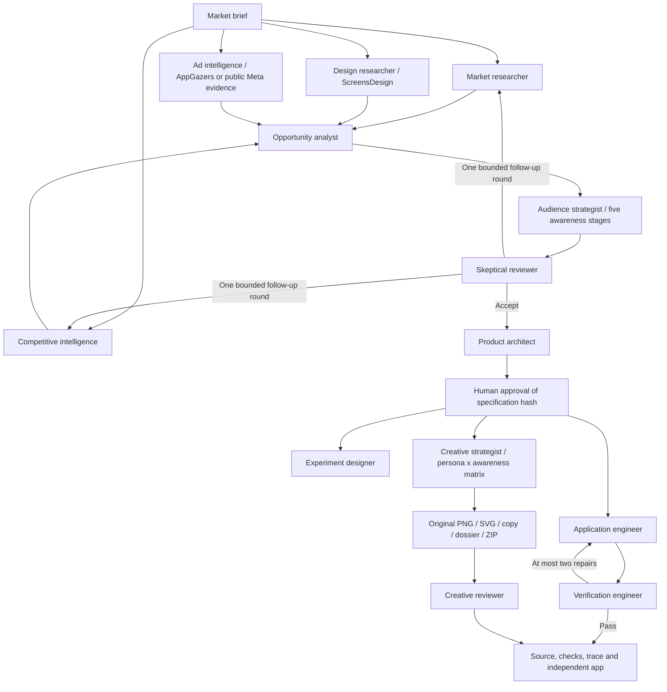

# Venture Studio

A local, thirteen-role research-to-prototype agent system around the consumer app
factory. Submit a market brief, inspect evidence and skeptical review, approve a
versioned product specification, and generate an independent Expo application.

## Start here

From the repository root, with foundation dependencies installed, install the
isolated server-only PNG renderer dependencies once:

```sh
npm run agent:setup
npm run agent:studio
```

Open **http://127.0.0.1:4317**. Leave **Fixture demo** selected and launch the
sample investigation. Select **Review product specification**, inspect it, then
**Approve specification & build**. The default repair demonstration injects one
real TypeScript error into generated source. Verification catches it and the
builder rewrites the source before verification runs again.

Explore **Evidence**, **Personas**, **Design**, **Ad research**, **Creatives**,
**Connections**, **Specification**, **Trace**, and **Code**. Evidence IDs on
features are clickable. Export downloads the complete run as JSON. Creatives
offers PNG/SVG previews, copy CSV, a research dossier and a complete ZIP pack.

The dashboard is separate local tooling. It does not change the foundation's
existing mobile feature or require native rebuilding to use the console.

### Populated Finch / Chillio samples

```sh
npm run agent:samples
```

This creates three completed, source-backed sample runs: **Little Steps**,
**Focus Pocket**, and **Soft Reset**. The command explicitly approves the sample
specifications, then runs actual generation, PNG/SVG export, checks and ZIP
packaging. It reuses completed samples with the same source version;
`-- --fresh` requests new runs.

Dashboard sample cards instead start at the usual human approval checkpoint.
Samples use `curated` mode: real previously inspected public source snapshots
with hypothetical persona/product/creative interpretations. No live search or
model execution is implied, and no model tokens are consumed.

Each sample includes 27 evidence records across 21 source URLs: Reddit discussions,
App Store review themes, official Finch/Chillio information, public ScreensDesign
references and actual Finch ad/campaign references. Excerpts, locators, dates and
source limits are visible in Evidence. Ad research shows two original indexed
static references separately from the generated drafts. See the
[source methodology and verification limits](research/README.md).

Each completed sample produces ten concepts, 30 PNGs and 30 editable SVGs across
two personas and five awareness stages. The complete launch ZIP includes generated
assets, copy CSV, metadata, the research dossier and structural QA. Original
competitor images are excluded from generated ad packs.

### Terminal demo

```sh
npm run agent:demo
# A custom brief, with a human approval checkpoint:
node factory/agent/cli.mjs run --mode demo --brief "Investigate flexible routines for people with changing schedules."
# Review the printed checkpoint, then supply the exact printed hash:
node factory/agent/cli.mjs resume RUN_ID --approve SPEC_HASH
node factory/agent/cli.mjs inspect RUN_ID
```

`agent:demo` explicitly supplies `--auto-approve` for unattended demonstrations.
The dashboard never accepts automatic approval from its client.

### Live agents

Provide `OPENAI_API_KEY` and `OPENAI_MODEL` as **server process environment
variables**, then restart `npm run agent:studio`. Select a model available to
your API project that supports Responses function calling and web search. The
runtime deliberately requires an explicit model rather than assuming access.
An ignored server env file can be loaded with Node's `--env-file` option:

```sh
node --env-file=.env.agent factory/agent/cli.mjs serve
```

Do not put the API key in any `EXPO_PUBLIC_*` variable, browser code, generated
application, recording, or committed file. The server does not automatically
read the mobile app's `.env`. Live mode is disabled when either setting is
absent. There is no silent fallback from live execution to fixtures.

The live provider implements the documented [Responses function-calling
loop](https://developers.openai.com/api/docs/guides/function-calling) with
[hosted web search](https://developers.openai.com/api/docs/guides/tools-web-search).
Role tasks use separate model contexts and tool permissions. Model access,
network behavior, search quality, and live generated output still need testing
with your own credentials; offline validation does not establish live quality.

## What is real in a fixture run?

| Capability | Fixture demo | Live mode |
| --- | --- | --- |
| Research and model decisions | Explicitly synthetic, deterministic fixtures | Responses API and hosted web search |
| Agent handoffs and supervisor | Real | Real |
| Schema, reference, permission and approval validation | Real | Real |
| File generation and feature source | Real filesystem writes; fixed sample concept | Tool-driven implementation from approved specification |
| TypeScript and regression checks | Real subprocesses | Real subprocesses |
| Repair | Real failure injection; deterministic corrective writes | Model interprets actual verification results |
| Run state, budgets, trace, pause/resume | Real | Real |
| Native behavior or market validation | Not verified | Not automatically verified |
| Personas, awareness and ad messaging | Explicitly synthetic hypotheses | Evidence-linked model analysis; still hypotheses |
| PNG/SVG static exports and ZIP | Actual original vector layouts rasterized locally | Actual exports from generated copy |
| ScreensDesign / AppGazers connections | Not used or claimed | Explicitly allowlisted remote MCP, when authorized |

Fixture mode always generates the same illustrative **Shift Flow** routine
tracker. Changing its brief demonstrates context propagation, not open-ended
product synthesis. Fictional competitors and `.example` evidence URLs are
labeled; they must not be presented as completed market research.

## Architecture



Folders follow the walkthrough order: who decides, who works, what they can
touch, what comes out.

- `runtime/` — the supervisor and the hard engineering.
  - `orchestrator.mjs`: deterministic state machine, role-scoped dependencies,
    parallel tasks, follow-up/repair limits, approval and artifact handoffs.
  - `store.mjs`: serialized atomic checkpoints and per-run process locks.
  - `validation.mjs`: runtime schema checks, specification hashes, evidence
    references and source URL provenance. A searched URL supports provenance,
    not proof that every claim is correct; skeptical review and human inspection
    remain necessary.
- `agents/` — the roles and the model loop.
  - `roles.mjs`: role instructions and strict structured artifact schemas.
  - `growth.mjs`: persona, design, ad research, creative and review contracts.
  - `provider.mjs`: bounded Responses tool loop and explicit fixture adapter.
- `tools/` — everything an agent can touch.
  - `workspace.mjs`: restricted source reads/writes, journaled app generation,
    fixed checks.
  - `mcp/`: remote MCP client, operator discovery and a local stdio server.
- `outputs/` — `creatives/render.mjs`, `launch-pack.mjs`: PNG/SVG rendering,
  structural checks, copy export, research dossier and portable ZIP packaging.
- `curated/` — `research/` source snapshots and `samples.mjs` sample runs.
- `studio/` — `server.mjs`, `public/`: loopback dashboard, source browser and
  trace export.
- `cli.mjs` — terminal entry point.

Research roles run concurrently. Each subsequent role receives only its declared
dependency artifacts, the brief, and relevant verification feedback. Shared
artifacts preserve task context across roles; they are not a shared unbounded
chat transcript. Historical artifact versions remain in the event trace.

The planner writes acceptance tests before any code exists: a contract for
`src/features/venture/model.ts`, one Jest file, and a coverage map that gives every
acceptance criterion either a named test or a reason it needs manual review.
`runtime/validation.mjs` rejects missing coverage, test names absent from the
source, and imports other than `@jest/globals` and the feature model. The tests
are part of the specification, so approval covers them. `tools/workspace.mjs`
installs them at `src/features/venture/acceptance.test.ts`, which the builder can
read but not write, restores the approved file before every check, and runs it as
the `acceptance-tests` check. Tests cover the model contract; screen behavior and
criteria marked for manual review still need a simulator or device.

Approval records the SHA-256 of the specification. A changed specification cannot
use an earlier approval. Research may request one follow-up round; unresolved
evidence gaps stop execution. Verification can request two repairs; unresolved
failures remain visible. An experiment artifact is a proposal, never a claim of
completed product experiments.

The shared budget permits at most 64 model requests, 160 tool reservations and
9,000 output tokens per request. Hosted research search reserves a tool slot
conservatively even when the model does not use it; the dashboard counts
reservations rather than claiming exact billable search calls. Token usage is
reported from API responses. No dollar-cost estimates are invented.

## Persistence and tool boundaries

Run files live under ignored `.agent-runs/RUN_ID/`. `state.json` is the durable
checkpoint and trace. `workspace/` contains the full generated app.

Pause takes effect after the current parallel tasks reach a checkpoint. On server
restart, interrupted runs without a live process lock become resumable. Completed
tasks with matching input hashes are reused. Generation has a separate staging
journal and identity check so replay does not create another application.
An interrupted model task may be reissued; its partial conversation is not
persisted. Request reservations survive checkpoints and are not refunded.

Researchers cannot write files. The builder can write only TypeScript source in
`src/features/venture/` and `src/app/(tabs)/index.tsx`. It cannot modify tests,
dependencies, configuration, authentication, billing, native code or secrets.
Reads reject secret files, path traversal and symbolic links. No model-authored
shell commands or npm lifecycle hooks are executed.

Verification uses the installed foundation compiler, a controlled dependency
symlink, and fixed foundation Jest test paths. It does not execute model-authored
tests. Child environments exclude API credentials and preload hooks. These are
application-level controls, **not an operating-system sandbox**. Review generated
source before running it on a simulator, and use a real sandbox/container before
offering execution to untrusted remote users. The console binds only to loopback,
checks Host/Origin, and should remain a local tool.

The factory excludes runs, tooling, native folders, secret files, dependencies,
and Git metadata from generated applications. Binary assets are copied without
text replacement. Run artifacts can contain your brief and public source data;
inspect exports before sharing.

## Verification and native preview

```sh
npm run agent:test
npm run typecheck
npm run lint
npm test -- --runInBand
```

The agent test suite covers permissions, provenance, budgets, stale approvals,
pause/resume, stateless API continuation, staging recovery, and local-server
origin checks. `npm run agent:demo` additionally exercises actual app generation,
type checking, regression tests and repair. Server tests need permission to bind
to loopback when run in a restricted environment.

To inspect native behavior, use the workspace printed by a completed run:

```sh
cd .agent-runs/RUN_ID/workspace
npm run ios
```

The generated application retains the foundation's onboarding/auth/settings and
dev-only unconfigured-service behavior. It is a development prototype. Complete
the original release checklist, vendor setup and real-device checks before any
release. TypeScript success and the foundation's tests do not prove that every
new feature acceptance criterion behaves correctly on a device.

See [the recording walkthrough](WALKTHROUGH.md) for a concise interview demo.
